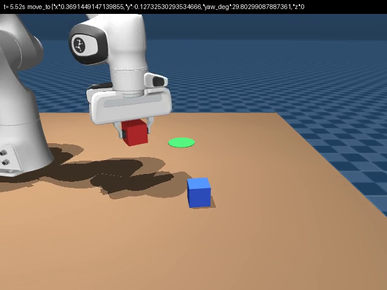

# pandawork

An LLM agent operates a simulated Franka Panda arm in MuJoCo through tools, the way it would
operate a real robot: it asks for sensor readings and images, commands motions, and declares
when it is done. The harness decides how much the agent may perceive (three access tiers), runs
seeded manipulation tasks that each come with a scripted reference solution, records every
episode for exact replay, and reports success from the state of the world rather than from what
the agent claims. No real robot is needed; everything runs on one Linux machine, and the scripted
parts need no LLM at all.



Contents: [Quick start](#quick-start) · [Concepts](#concepts) · [Tools](#tools-the-agent-gets) ·
[Tasks](#tasks) · [Running](#running) · [Episode files](#episode-files) ·
[Extending](#extending) · [Code layout](#code-layout) · [Testing](#testing) ·
[Troubleshooting](#troubleshooting) · [Credits and licence](#credits-and-licence)

## Quick start

Requirements: Linux, Python 3.10+, `ffmpeg` on your PATH for videos, and a desktop session only
if you want the live viewer. Offscreen rendering uses EGL and works headless; your user may need
to be in the `render` group (`sudo usermod -aG render $USER`, then log out and in).

```bash
git clone https://github.com/Khandakar227/pandawork.git && cd pandawork
python3 -m venv .venv && source .venv/bin/activate
pip install -e ".[dev]"
python -m pytest -q                       # about 2.5 minutes, no network

# 1. A scripted solution, recorded and rendered to MP4 (no LLM involved)
python scripts/episodes.py record pick_place --seed 3 --video
# -> runs/pick_place-privileged-s3/video_side.mp4

# 2. The same kind of episode live in the MuJoCo viewer
python scripts/oracle_eval.py --watch pick_place --seed 0

# 3. Replay the recording and check it reproduces the world exactly
python scripts/episodes.py replay runs/pick_place-privileged-s3
```

To let Claude drive the arm, install [Claude Code](https://claude.com/claude-code), log in
(`claude` on your PATH), and add the agent extra. The agent runs through your Claude Code
login; no API key is involved.

```bash
pip install -e ".[agent]"
python scripts/run_agent.py pick_place --tier realistic --seed 3 --watch   # about $0.10
python scripts/live.py                                                      # type instructions, watch the arm
```

In the viewer, the panel at the top left shows the instruction, what the agent last said, the
tool call running now, its result, and the budget. A green sphere marks the current motion target.

## Concepts

**Plant and self-model.** The *plant* is the MuJoCo model that actually moves. The *self-model*
is a second copy that the robot reasons with: forward kinematics, inverse kinematics, gravity
compensation, and every tool report ("fingertip at ...", "reached, error 0.6 mm") come from the
self-model fed with the encoder readings, the way a real controller works from its own model
rather than from ground truth. Nothing the agent reads in the realistic and vision-only tiers
comes from the plant directly.

**Tiers.** How much of the simulation the agent may perceive:

| tier | what the agent gets |
|---|---|
| `privileged` | everything the simulator knows: exact object poses, mechanism states, true contacts, the true fingertip. No noise. The "told the truth" control. |
| `realistic` | what a real robot has: encoders, wrist force/torque, finger touch, cameras, object detection from images; all with noise. |
| `vision_only` | camera images and gripper state. Motion reports carry no coordinates. |

**Episodes.** One task instance: `(task, tier, seed)`. The seed fixes the scene layout and
the sensor noise, so an episode replays exactly from its log. Each episode has a budget (tool
calls and simulated seconds); the agent ends it with `done`, claiming success or failure, and the
harness judges success from the state of the world.

**Oracles.** Every task has a scripted solution that uses the same tools and skills as the agent.
It proves the task is solvable, calibrates difficulty, and is the free pipeline check.

## Tools the agent gets

| group | tool | notes |
|---|---|---|
| perceive | `get_robot_state` | joint angles, gripper opening, believed fingertip pose |
| | `look` | a camera image (`front`, `top`, `side`, `wrist`), small or medium, optional crop |
| | `detect_objects` | objects visible to a camera, with positions from segmentation and depth |
| | `get_contacts` | what the hand touches (realistic: fingertip pad forces and external wrist force only) |
| | `read_wrist_ft` | external force on the hand |
| | `get_object_poses`, `get_fixture_states` | exact simulator state, **privileged only** |
| act | `move_to` | fingertip centre to (x, y, z), pointing down or forward, closed loop; stops on unexpected contact and reports `reached` / `partial` |
| | `move_relative` | offset from the believed fingertip |
| | `move_joints` | joint-space move |
| | `gripper` | open or close; after closing, says whether something is held |
| | `wait` | let things settle |
| predict | `check_reachable` | can the gripper get there, from the self-model |
| | `simulate` | run a plan on a twin world first, **privileged only** |
| meta | `get_task`, `done` | the instruction and object names; end the episode with a claim |

`vision_only` keeps `get_robot_state`, `look`, `gripper`, `move_to`, `move_relative`, `wait`,
`check_reachable`, `get_task`, `done`. `python scripts/tool_console.py --schemas` prints the
exact definitions the agent receives; `python scripts/tool_console.py --demo` is a guided tour
of the tools from the terminal.

## Tasks

| task | level | the instruction, in short |
|---|---|---|
| `reach` | 1 | hover 5 cm above a named cube among three |
| `pick_place` | 1 | put the named cube on the green pad |
| `press_button` | 1 | press one of two buttons, not the other |
| `open_drawer` | 1 | pull the drawer open by its handle, at least 10 cm |
| `stack` | 2 | build a three-cube tower in a given order |
| `sort` | 2 | two red and two blue cubes into the bins of their colour |
| `stow` | 2 | open the drawer, put a cube inside, close it |
| `press_key` | 1 | press one key on a wall-mounted 3×3 keypad (gripper pointing forward) |
| `type_code` | 2 | type a 4-digit code on a keypad whose digits are shuffled |
| `playground` | — | free play for the live console: cubes, a pad, a button, no goal |

Every task reports success, a *progress* score (0..1, partial credit), and a key metric. Oracles
succeed on at least 95 % of seeds: `python scripts/oracle_eval.py` checks all of them. The two
keypad tasks are hard for image-only agents: the keys sit 4 cm apart, carry no label readable
outside the privileged tier, and open fingers press the neighbouring key.

## Running

**One agent episode** (recorded under `runs/agent/<task>-<tier>-s<seed>-<timestamp>/`):

```bash
python scripts/run_agent.py pick_place --tier realistic --seed 3
python scripts/run_agent.py press_button --effort high --max-usd 0.5 --quiet
```

| option | |
|---|---|
| `--tier`, `--seed` | the episode |
| `--model` (default `claude-sonnet-5-5`), `--effort` | model settings |
| `--max-calls` (40), `--max-usd` (1.0) | the budget and a hard cost stop |
| `--watch`, `--realtime 2`, `--hold` | show it in the viewer, at 2× speed, keep the window at the end |

The terminal prints the agent's reasoning summaries, each tool call and result, the verdict, the
claim and the cost. Typical costs in our runs: $0.03 for `reach`, $0.05–0.17 for `pick_place`.

**The live console**: `python scripts/live.py [--task pick_place --seed 3 --tier realistic]`.
Type an instruction at the `you>` prompt, then follow-ups; one conversation runs across them.
`:check` runs the task's success check, `:cost` the ledger, `:quit` ends. Sessions are recorded
under `runs/live/`.

**Scripted oracles**: `python scripts/oracle_eval.py [--tasks ...] [--seeds N]`
scores them; `python scripts/episodes.py record <task> --seed N [--tier T] [--video]` records one.

**Watching.** Any run can be watched in MuJoCo's passive viewer: `--watch` on `run_agent.py`
and `batch.py run`, `--watch <task>` on `oracle_eval.py`, and `live.py` always. Drag to orbit, scroll to zoom, `Tab` shows MuJoCo's side panels. Closing the
window stops the display only; the episode runs on and is still recorded. `--realtime 0` runs
unpaced. After the fact: `python scripts/episodes.py replay <folder>` re-executes the log and
checks it reproduces the recorded world exactly; `video <folder> --camera side` renders an MP4;
`show <folder>` prints the transcript.

**Batches.** A batch is a grid of task × tier × seed, run in tier-major order (the tier's
prompt stays in the prompt cache), under a total cost cap. Each episode lives in
`runs/batch/<name>/<task>-<tier>-s<seed>/`.

```bash
# free pipeline check with the oracles
python scripts/batch.py run oracle-check --agent oracle --tasks reach pick_place --seeds 0-1

# an agent batch: two tasks, three tiers, five seeds
python scripts/batch.py run demo --tasks pick_place press_button \
       --tiers privileged realistic vision_only --seeds 0-4 --max-calls 60 --max-total-usd 15
python scripts/batch.py report demo                # the tables, report.json and episodes.csv
```

Stop a batch at any time and re-run the same command: finished episodes (those with a
`result.json`) are skipped, a half-done one is set aside as `<name>.incomplete-<time>` and
re-run. Any folder with a dot in its name is ignored by resume, reports and analysis, so
`mv <episode> <episode>.bad` re-runs it. Use a fresh batch name per experiment. When the Claude
subscription's usage limit is hit, the batch waits for the reset and continues by itself.

**The report.** `report.md`, `report.json` and `episodes.csv` in the batch folder give, per
tier, task and their crossing: success with a Wilson 95 % interval, mean progress, claimed
successes and over-claims (claimed success, world says no), episodes ending without `done`,
turns, calls, images, cost per episode and per success, the task's key metric, and disturbed
bystander objects (an object the task is not about moved by more than 1 cm). The CSV has one row
per episode with the same columns, for plotting.

## Episode files

```
runs/agent/pick_place-realistic-s0-20261016-022537/
├── meta.json        task, tier, seed, model, prompt, harness commit
├── events.jsonl     every bus message: tool calls, results, the agent's messages, sensor streams
├── streams.npz, snapshots.npz, blobs/   sensor data and images for replay
├── result.json      verdict, claim, progress, side effects, usage and cost
└── truth.jsonl      simulator truth around each tool call (fingertip, object poses, contacts): for analysis only, never shown to the agent
```

Truth goes only through the recorder, never through a tool, so the realistic and vision-only
tiers see exactly what a real robot would.

## Extending

**A task.** Subclass `Task` in `src/pandawork/tasks/library.py`: set `name` and `level`,
build the scene in `build_spec` (helpers in `core/scene.py`: cubes, pads, buttons, a drawer,
bins, a keypad), place objects from the seeded `rng` in `reset` and write `self.instruction`,
track what matters in `monitor` (called every step), score in `evaluate` (an `Evaluation` with
success, a one-line summary, metrics and `progress`), and write the `oracle` with the same tool
calls the agent has (`call(d, ("move_to", {...}), ...)`). Add it to the `TASKS` table at the bottom
of the file and a case to `tests/test_tasks.py`. Read `PressButtonTask` first: forty lines cover
all six parts.

**A tool.** Subclass `Tool` in `src/pandawork/tools/robot_tools.py`: `name`, `group`,
`Args` (a pydantic model: this becomes the schema the agent sees), `description`, `tiers`
(which tiers may call it; default all), and `run(ctx, args) -> ToolResult`. Register it in `default_registry()` at the
bottom of the file; the tier gate, budget accounting, recording and
replay come for free. `CheckReachable` is the smallest example. Add a case to
`tests/test_robot_tools.py`, and keep plant truth out of anything a non-privileged tier may call.

**A perception tier.** Add a member to `Tier` in `src/pandawork/tiers.py`, a noise entry per
sensor in `world/sensors.py` (each sensor maps tiers to a `Gaussian` or `PixelNoise`), the tools
it may use (the `tiers` attribute on each tool), and its paragraph of the system prompt in
`agent/prompt.py`.

**Another robot.** The Panda is a block of constants at the top of `core/robot.py` plus three
builder functions; [docs/adding-a-robot.md](docs/adding-a-robot.md) walks through swapping it and
what the kinematics and gripper code assume.

**Another agent.** `src/pandawork/agent/bridge.py` exposes the tools as an MCP server named
`panda`; any client that speaks MCP can drive an episode, and the episode ends when the client
calls `done` with its claim. `runner.py` shows the loop around one episode (options, prompt,
budget, usage ledger); `session.py` is the Claude Agent SDK specific part.

**A real robot.** The physical boundary is `World` in `src/pandawork/world/world.py`;
[docs/real-robot-backend.md](docs/real-robot-backend.md) lists what a hardware backend must
provide and which features cannot exist off the simulator.

How the pieces fit, from a tool call to a simulator step to the event log:
[docs/architecture.md](docs/architecture.md).

## Code layout

```
src/pandawork/
├── core/        robot model and scenes (robot.py, scene.py), IK and the self-model (ik.py), controller
│                (control.py), rendering, viewer helpers
├── world/       World: plant + self-model + clock + event bus; sensors with tier noise; fork() for twins
├── skills/      closed-loop motion and perception routines, shared by the agent's tools and the oracles
├── tools/       the tool registry, tier gate, budgets, dispatcher, robot_tools.py (the 16 tools)
├── tasks/       Task base (success, progress, oracle), library.py (the tasks), episode.py (make_episode)
├── agent/       Claude through the Agent SDK: prompt.py, bridge.py (tools as an MCP server),
│                runner.py (one episode), live.py (interactive), session.py (options, usage)
├── recording/   recorder (events, truth), exact replay, video
├── evaluation/  batch.py (resumable grids), report.py (tables, CSV)
├── watch.py     viewer panel and markers; Watch hook for any runner
└── tiers.py
scripts/         episodes, oracle_eval, run_agent, live, batch, tool_console, bus_monitor, snapshot, reach_demo, reach_eval
tests/           pytest suite (tools: test_robot_tools.py; batches: test_batch_grid.py; recording and replay: test_recording.py; repo hygiene: test_repo_hygiene.py)
docs/            adding-a-robot, real-robot-backend, architecture
```

## Testing

`python -m pytest -q` runs everything in about 2.5 minutes without network or an LLM. Useful subsets:

```bash
python -m pytest -q tests/test_robot_tools.py       # every tool, per tier
python -m pytest -q tests/test_tasks.py             # every task's scene, scoring and oracle
python -m pytest -q tests/test_evaluation.py tests/test_batch_grid.py   # batches resume, pause, report
python scripts/oracle_eval.py                       # oracle success over 50 seeds per task (~5 min)
python scripts/bus_monitor.py --check-determinism
```

## Troubleshooting

- **`EGLError` tracebacks at exit** are harmless; results are written before them.
- **`pandawork: corrupted seg render ... renderers rebuilt`** on stderr: a GL context was lost and rebuilt; the episode continues. If it repeats, check `MUJOCO_GL` (EGL is the default on Linux) and the `render` group.
- **`ffmpeg not found on PATH`**: install ffmpeg (`sudo apt install ffmpeg`); only video rendering needs it.
- **`ModuleNotFoundError: No module named 'pandawork'`** after moving or renaming the folder: the editable install points at the old path; run `pip install -e .` again.
- **`JSON message exceeded maximum buffer size`** in an episode's `result.json` error: an SDK older than the one pinned, or `max_buffer_size` removed from the session options; a noisy 640x480 image is a ~500 KB message.
- **Viewer segfault or hang on close** (seen on Wayland): scripts end through `core/viewer.py:exit_after`, which skips interpreter teardown. Logs are already closed by then.
- **ROS 2 sourced in the shell**: `pytest` still works; the project config disables ROS's pytest plugins.
- **`claude` not found**: install Claude Code and log in, or pass the path through `AgentConfig(cli_path=...)`.
- **Usage limit reached** mid-batch: nothing to do; the batch waits for the reset and resumes. Re-running the command later also resumes.
- **An episode ran without `done`**: the call budget was hit; raise `--max-calls`.

## Credits and licence

The Franka Panda model under `assets/franka_emika_panda/` comes from
[MuJoCo Menagerie](https://github.com/google-deepmind/mujoco_menagerie) (Apache 2.0; its licence
and changelog are kept alongside). Everything else is MIT, see `LICENSE`.
